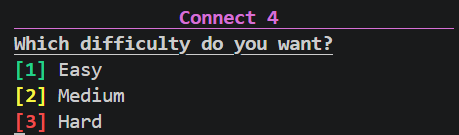

# Connect4

A simple terminal application made in Rust that allows the user to play Connect 4. This Connect 4 implementation supports two main modes of play: multiplayer and computer.

## Multiplayer
The game supports local multiplayer on the same device as well as automatic win detection.

## Computer
The computer play has three different difficulty levels: easy, medium, and hard.

The computer uses a simple minimax algorithm along with alpha-beta pruning to improve evaluation speed. The heuristic evaluation is pretty unoptimized though and can definitely be tuned to make the computer play much better.